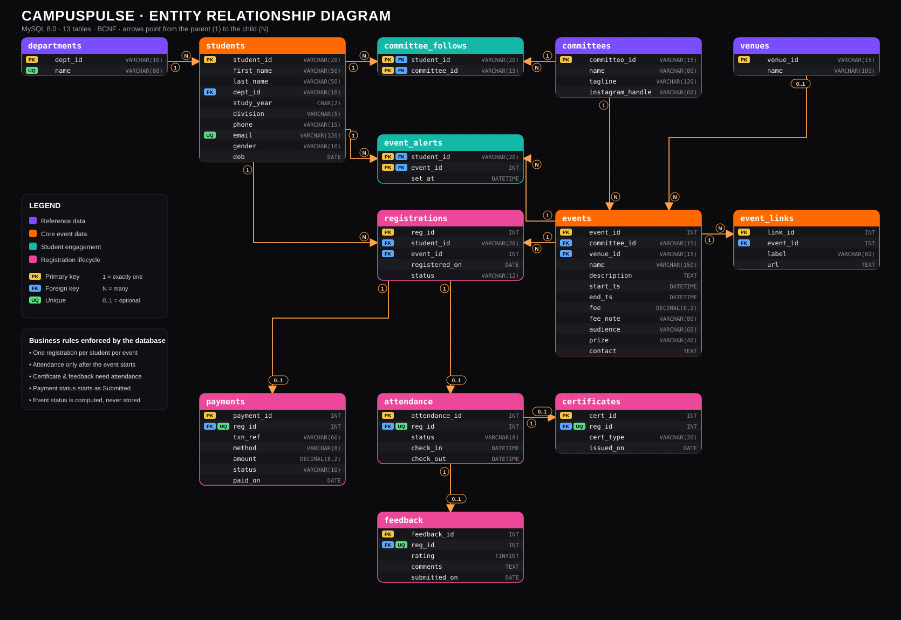
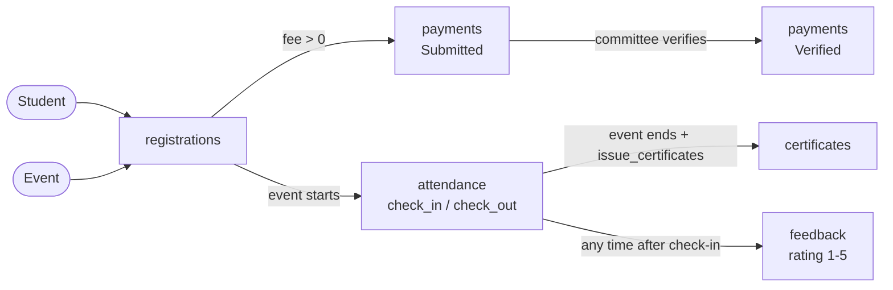
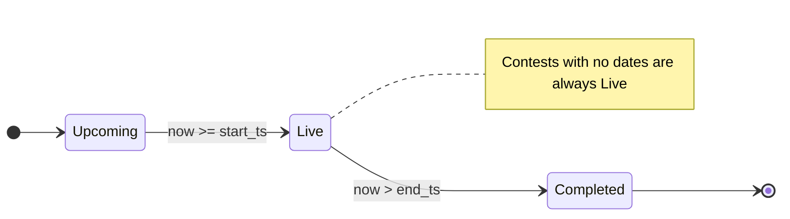

# CampusPulse 🟧

**Live Committee Events Platform for SPIT — Registration, Payments, Attendance, Feedback & Certificates**

    

## 📖 Table of Contents
- [Overview](#-overview--problem-statement) · [Features](#-key-features--business-logic) · [Roles](#-user-roles--capabilities) · [Database](#️-database-design--normalization) · [Updating Data](#-how-event-data-stays-up-to-date) · [Stack](#-technology-stack) · [Structure](#-project-structure) · [Setup](#-getting-started--local-setup) · [API](#-api-overview) · [Team](#-academic-project--team)

> Departments supported: **EXTC, CSE, CE**. The UI also has a custom animated cursor.

## 🌟 Overview & Problem Statement
SPIT committees announce events through Instagram posters and WhatsApp forms. This causes missed events, untracked payments, no attendance record and certificates that nobody can verify. **CampusPulse** brings every committee into one platform where an event's status is computed live, payments are logged against a reference, attendance is recorded at the desk, and certificates are issued automatically.

## ⚡ Key Features & Business Logic
1. **Computed live status** — an event is `up`, `live` or `done` from its start/end time (the `event_status` view); nothing is stored, so nothing goes stale. Contests with no dates are "ongoing".
2. **Payment ledger** — paid events require a transaction reference (6+ chars); payments start as `Submitted` until a committee member verifies them.
3. **Attendance window** — a trigger blocks check-in before the event starts; check-out is optional.
4. **Automatic certificates** — `issue_certificates()` issues a certificate only for attended students once the event has ended (the same idea as a batch refresh job).
5. **Verified feedback** — rating (1–5) is only possible for students with recorded attendance, enforced by the foreign key to `attendance`.
6. **Follow & alert** — students follow committees and set per-event alerts (`committee_follows`, `event_alerts`).

## 👥 User Roles & Capabilities
| Role | Persona | Capabilities |
|---|---|---|
| **Admin** | Faculty coordinator | Choose a committee to review its applications and feedback; manage catalog and reports |
| **Committee member** | Core team | Review applications and feedback, manage attendance, and cancel registrations for own committee |
| **Student** | Any SPIT student | Browse, follow, register, pay, view certificates, give feedback |

## 🗄️ Database Design & Normalization

All DDL lives in [`schema/schema.sql`](schema/schema.sql); sample data in [`schema/seed.sql`](schema/seed.sql). The model was designed top-down: entities -> relationships -> constraints -> normalization -> business logic pushed into the database.

| Property | Value |
|---|---|
| DBMS | MySQL 8.0+ (InnoDB, `utf8mb4`) |
| Tables | 13 (4 reference/core, 2 engagement, 5 lifecycle, 2 supporting) |
| Views | 3 — `event_status`, `dept_summary`, `admin_student_signup_details` |
| Trigger | 1 — `trg_attendance` |
| Stored procedure | 1 — `issue_certificates()` |
| Normal form | BCNF (every determinant is a candidate key) |
| Time zone | `DATETIME` values stored in IST (Asia/Kolkata) |
| Primary keys | Surrogate `AUTO_INCREMENT` ids for transactional rows; natural codes (`dept_id`, `committee_id`, `student_id`) for stable reference data |

### Entity-Relationship Diagram



> **How to read it:** each box is a table; **PK** = primary key, **FK** = foreign key, **UQ** = unique. Arrows point from the **parent (1)** to the **child (N)**. Colours group tables by purpose. High-resolution copy: [`docs/er-diagram.png`](docs/er-diagram.png).

<details><summary><b>Same diagram as text (Mermaid, renders on GitHub)</b></summary>

```mermaid
erDiagram
    departments ||--o{ students : "dept_id"
    students ||--o{ committee_follows : "student_id"
    committees ||--o{ committee_follows : "committee_id"
    committees ||--o{ events : "committee_id"
    venues |o--o{ events : "venue_id"
    events ||--o{ event_links : "event_id"
    students ||--o{ registrations : "student_id"
    events ||--o{ registrations : "event_id"
    students ||--o{ event_alerts : "student_id"
    events ||--o{ event_alerts : "event_id"
    registrations ||--o| payments : "reg_id"
    registrations ||--o| attendance : "reg_id"
    attendance ||--o| certificates : "reg_id"
    attendance ||--o| feedback : "reg_id"
    departments {
        VARCHAR(10) dept_id PK
        VARCHAR(80) name UQ
    }
    students {
        VARCHAR(20) student_id PK
        VARCHAR(50) first_name
        VARCHAR(50) last_name
        VARCHAR(10) dept_id FK
        CHAR(2) study_year
        VARCHAR(5) division
        VARCHAR(15) phone
        VARCHAR(120) email UQ
        VARCHAR(10) gender
        DATE dob
    }
    committee_follows {
        VARCHAR(20) student_id PK, FK
        VARCHAR(15) committee_id PK, FK
    }
    committees {
        VARCHAR(15) committee_id PK
        VARCHAR(80) name
        VARCHAR(120) tagline
        VARCHAR(60) instagram_handle
    }
    venues {
        VARCHAR(15) venue_id PK
        VARCHAR(100) name
    }
    event_alerts {
        VARCHAR(20) student_id PK, FK
        INT event_id PK, FK
        DATETIME set_at
    }
    registrations {
        INT reg_id PK
        VARCHAR(20) student_id FK
        INT event_id FK
        DATE registered_on
        VARCHAR(12) status
    }
    events {
        INT event_id PK
        VARCHAR(15) committee_id FK
        VARCHAR(15) venue_id FK
        VARCHAR(150) name
        TEXT description
        DATETIME start_ts
        DATETIME end_ts
        DECIMAL(8,2) fee
        VARCHAR(80) fee_note
        VARCHAR(60) audience
        VARCHAR(40) prize
        TEXT contact
    }
    event_links {
        INT link_id PK
        INT event_id FK
        VARCHAR(60) label
        TEXT url
    }
    payments {
        INT payment_id PK
        INT reg_id FK, UQ
        VARCHAR(60) txn_ref
        VARCHAR(8) method
        DECIMAL(8,2) amount
        VARCHAR(10) status
        DATE paid_on
    }
    attendance {
        INT attendance_id PK
        INT reg_id FK, UQ
        VARCHAR(8) status
        DATETIME check_in
        DATETIME check_out
    }
    certificates {
        INT cert_id PK
        INT reg_id FK, UQ
        VARCHAR(20) cert_type
        DATE issued_on
    }
    feedback {
        INT feedback_id PK
        INT reg_id FK, UQ
        TINYINT rating
        TEXT comments
        DATE submitted_on
    }
```
</details>

### Table Groups

| Layer | Tables | Purpose |
|---|---|---|
| 🟪 Reference data | `departments`, `committees`, `venues` | Small, stable lookup tables |
| 🟧 Core event data | `events`, `event_links`, `students` | The main business entities |
| 🟩 Student engagement | `committee_follows`, `event_alerts` | Many-to-many follow / notify links |
| 🟥 Registration lifecycle | `registrations`, `payments`, `attendance`, `certificates`, `feedback` | The transaction chain from sign-up to certificate |

### Relationships & Referential Actions

| # | Parent | | Child | FK column | Cardinality | ON DELETE | Meaning |
|---|---|---|---|---|---|---|---|
| 1 | `departments` | ➜ | `students` | `dept_id` | 1 : N | RESTRICT | A department has many students |
| 2 | `students` | ➜ | `committee_follows` | `student_id` | 1 : N | CASCADE | A student follows many committees |
| 3 | `committees` | ➜ | `committee_follows` | `committee_id` | 1 : N | RESTRICT | A committee has many followers |
| 4 | `committees` | ➜ | `events` | `committee_id` | 1 : N | RESTRICT | A committee organises many events |
| 5 | `venues` | ➜ | `events` | `venue_id` | 0..1 : N | RESTRICT | An event may have a venue; a venue hosts many events |
| 6 | `events` | ➜ | `event_links` | `event_id` | 1 : N | CASCADE | An event has many registration / info links |
| 7 | `students` | ➜ | `registrations` | `student_id` | 1 : N | CASCADE | A student registers for many events |
| 8 | `events` | ➜ | `registrations` | `event_id` | 1 : N | RESTRICT | An event receives many registrations |
| 9 | `students` | ➜ | `event_alerts` | `student_id` | 1 : N | CASCADE | A student sets many alerts |
| 10 | `events` | ➜ | `event_alerts` | `event_id` | 1 : N | CASCADE | An event has many alert subscribers |
| 11 | `registrations` | ➜ | `payments` | `reg_id` | 1 : 0..1 | CASCADE | A paid registration has exactly one payment |
| 12 | `registrations` | ➜ | `attendance` | `reg_id` | 1 : 0..1 | CASCADE | A registration has at most one attendance record |
| 13 | `attendance` | ➜ | `certificates` | `reg_id` | 1 : 0..1 | CASCADE | An attended registration earns at most one certificate |
| 14 | `attendance` | ➜ | `feedback` | `reg_id` | 1 : 0..1 | CASCADE | An attended registration allows at most one rating |

`CASCADE` removes dependants automatically (deleting a student removes their registrations, payments, attendance, certificates and feedback). `RESTRICT` blocks deleting data that is still in use (you cannot delete a committee that has events).

### Registration Lifecycle





### Data Dictionary

#### `departments` — Reference data

| Column | Type | Key | Null | Notes |
|---|---|---|---|---|
| `dept_id` | VARCHAR(10) | PK | NO | Department code: EXTC, CSE, CE |
| `name` | VARCHAR(80) | UQ | NO | Full department name |

**Constraints:** UNIQUE `name`

#### `students` — Core event data

| Column | Type | Key | Null | Notes |
|---|---|---|---|---|
| `student_id` | VARCHAR(20) | PK | NO | College roll / UID |
| `first_name` | VARCHAR(50) | — | NO | Given name |
| `last_name` | VARCHAR(50) | — | NO | Family name |
| `dept_id` | VARCHAR(10) | FK | NO | -> departments |
| `study_year` | CHAR(2) | — | NO | FE / SE / TE / BE |
| `division` | VARCHAR(5) | — | NO | Class division |
| `phone` | VARCHAR(15) | — | YES | Contact number |
| `email` | VARCHAR(120) | UQ | YES | Unique email |
| `gender` | VARCHAR(10) | — | YES | Female / Male / Other |
| `dob` | DATE | — | YES | Date of birth |

**Constraints:** FK `dept_id` (RESTRICT) · UNIQUE `email` · CHECK `study_year IN ('FE','SE','TE','BE')` · CHECK `gender IN ('Female','Male','Other')`

#### `committee_follows` — Student engagement

| Column | Type | Key | Null | Notes |
|---|---|---|---|---|
| `student_id` | VARCHAR(20) | PK, FK | NO | -> students |
| `committee_id` | VARCHAR(15) | PK, FK | NO | -> committees |

**Constraints:** Composite PK `(student_id, committee_id)` · FK student (CASCADE), committee (RESTRICT)

#### `committees` — Reference data

| Column | Type | Key | Null | Notes |
|---|---|---|---|---|
| `committee_id` | VARCHAR(15) | PK | NO | Short code: IEEE, CSI, ECELL... |
| `name` | VARCHAR(80) | — | NO | Display name |
| `tagline` | VARCHAR(120) | — | YES | One-line description |
| `instagram_handle` | VARCHAR(60) | — | YES | Instagram username (nullable) |

**Constraints:** —

#### `venues` — Reference data

| Column | Type | Key | Null | Notes |
|---|---|---|---|---|
| `venue_id` | VARCHAR(15) | PK | NO | Venue code |
| `name` | VARCHAR(100) | — | NO | Venue name |

**Constraints:** —

#### `event_alerts` — Student engagement

| Column | Type | Key | Null | Notes |
|---|---|---|---|---|
| `student_id` | VARCHAR(20) | PK, FK | NO | -> students |
| `event_id` | INT | PK, FK | NO | -> events |
| `set_at` | DATETIME | — | NO | When the alert was set |

**Constraints:** Composite PK `(student_id, event_id)` · FK student (CASCADE), event (CASCADE)

#### `registrations` — Registration lifecycle

| Column | Type | Key | Null | Notes |
|---|---|---|---|---|
| `reg_id` | INT | PK | NO | Auto-increment, shown as REG1001 |
| `student_id` | VARCHAR(20) | FK | NO | -> students |
| `event_id` | INT | FK | NO | -> events |
| `registered_on` | DATE | — | NO | Defaults to today |
| `status` | VARCHAR(12) | — | NO | Confirmed / Cancelled |

**Constraints:** UNIQUE `(student_id, event_id)` · FK student (CASCADE), event (RESTRICT) · CHECK `status IN ('Confirmed','Cancelled')` · INDEX `idx_reg_event`

#### `events` — Core event data

| Column | Type | Key | Null | Notes |
|---|---|---|---|---|
| `event_id` | INT | PK | NO | Auto-increment |
| `committee_id` | VARCHAR(15) | FK | NO | -> committees (organiser) |
| `venue_id` | VARCHAR(15) | FK | YES | -> venues, NULL = to be announced |
| `name` | VARCHAR(150) | — | NO | Event title |
| `description` | TEXT | — | YES | Details |
| `start_ts` | DATETIME | — | YES | NULL for ongoing contests |
| `end_ts` | DATETIME | — | YES | NULL for ongoing contests |
| `fee` | DECIMAL(8,2) | — | YES | NULL = see registration form |
| `fee_note` | VARCHAR(80) | — | YES | e.g. Solo, Duo Rs.200 |
| `audience` | VARCHAR(60) | — | YES | Eligible years / group |
| `prize` | VARCHAR(40) | — | YES | Prize pool |
| `contact` | TEXT | — | YES | Queries contact |

**Constraints:** FK `committee_id` (RESTRICT), `venue_id` (RESTRICT) · CHECK `fee IS NULL OR fee >= 0` · CHECK start/end are both NULL or both set, and `end_ts >= start_ts` · INDEX `idx_events_start`

#### `event_links` — Core event data

| Column | Type | Key | Null | Notes |
|---|---|---|---|---|
| `link_id` | INT | PK | NO | Auto-increment |
| `event_id` | INT | FK | NO | -> events |
| `label` | VARCHAR(60) | — | NO | Button text |
| `url` | TEXT | — | NO | Registration / info URL |

**Constraints:** FK `event_id` (CASCADE)

#### `payments` — Registration lifecycle

| Column | Type | Key | Null | Notes |
|---|---|---|---|---|
| `payment_id` | INT | PK | NO | Auto-increment |
| `reg_id` | INT | FK, UQ | NO | -> registrations, one payment each |
| `txn_ref` | VARCHAR(60) | — | NO | UPI ref / receipt no. (6+ chars) |
| `method` | VARCHAR(8) | — | NO | UPI / Card / Cash |
| `amount` | DECIMAL(8,2) | — | NO | Copied from event fee, > 0 |
| `status` | VARCHAR(10) | — | NO | Submitted / Verified / Rejected |
| `paid_on` | DATE | — | NO | Payment date |

**Constraints:** UNIQUE `reg_id` · FK reg_id (CASCADE) · CHECK `CHAR_LENGTH(txn_ref) >= 6` · CHECK `method IN ('UPI','Card','Cash')` · CHECK `amount > 0` · CHECK `status IN ('Submitted','Verified','Rejected')`

#### `attendance` — Registration lifecycle

| Column | Type | Key | Null | Notes |
|---|---|---|---|---|
| `attendance_id` | INT | PK | NO | Auto-increment |
| `reg_id` | INT | FK, UQ | NO | -> registrations |
| `status` | VARCHAR(8) | — | NO | Present |
| `check_in` | DATETIME | — | NO | Blocked before event start |
| `check_out` | DATETIME | — | YES | Optional, >= check_in |

**Constraints:** UNIQUE `reg_id` · FK reg_id (CASCADE) · CHECK `check_out IS NULL OR check_out >= check_in` · TRIGGER `trg_attendance`

#### `certificates` — Registration lifecycle

| Column | Type | Key | Null | Notes |
|---|---|---|---|---|
| `cert_id` | INT | PK | NO | Shown as CERT1001 |
| `reg_id` | INT | FK, UQ | NO | -> attendance (attended only) |
| `cert_type` | VARCHAR(20) | — | NO | Participation |
| `issued_on` | DATE | — | NO | Issue date |

**Constraints:** UNIQUE `reg_id` · FK reg_id -> **attendance** (CASCADE), so only attended students can hold a certificate

#### `feedback` — Registration lifecycle

| Column | Type | Key | Null | Notes |
|---|---|---|---|---|
| `feedback_id` | INT | PK | NO | Auto-increment |
| `reg_id` | INT | FK, UQ | NO | -> attendance (attended only) |
| `rating` | TINYINT | — | NO | 1 to 5 |
| `comments` | TEXT | — | YES | Free text |
| `submitted_on` | DATE | — | NO | Submission date |

**Constraints:** UNIQUE `reg_id` · FK reg_id -> **attendance** (CASCADE) · CHECK `rating BETWEEN 1 AND 5`

### Business Rules Enforced in the Database

| Rule | Mechanism |
|---|---|
| A student can register for an event only once | `UNIQUE (student_id, event_id)` on `registrations` |
| A registration has at most one payment, attendance, certificate and feedback | `UNIQUE (reg_id)` on each child table |
| Certificates and feedback exist only for attended students | `reg_id` references `attendance`, not `registrations` |
| Attendance cannot be recorded before the event starts | `trg_attendance` raises `SQLSTATE 45000` |
| Check-out cannot precede check-in | `CHECK (check_out >= check_in)` |
| Payment needs a real reference and positive amount | `CHECK (CHAR_LENGTH(txn_ref) >= 6)`, `CHECK (amount > 0)` |
| Ratings are 1 to 5 | `CHECK (rating BETWEEN 1 AND 5)` |
| Event end is never before start; ongoing contests have no dates | `CHECK` on `start_ts` / `end_ts` |
| Registration + payment succeed or fail together | One transaction in the API (`server/index.js`) |
| Event status can never be stale | Computed by the `event_status` view, never stored |

### Views, Trigger & Stored Procedure

| Object | Type | Description |
|---|---|---|
| `event_status` | View | Adds `status` = `up`, `live` or `done` to every event from `NOW()` |
| `dept_summary` | View | Students, attended registrations and certificates per department |
| `trg_attendance` | `BEFORE INSERT` trigger | Rejects check-in before the event starts |
| `issue_certificates()` | Stored procedure | Idempotently issues a certificate to every attended student whose event has ended |

```sql
CALL issue_certificates();   -- returns the number of certificates issued
```

### Indexes

| Index | Table / columns | Speeds up |
|---|---|---|
| `PRIMARY` | every table | Row lookup and joins |
| `UNIQUE` | `departments.name`, `students.email`, `(student_id, event_id)`, `reg_id` on each child | Integrity + lookups |
| `idx_events_start` | `events(start_ts)` | Sorting and the live / upcoming / completed split |
| `idx_reg_event` | `registrations(event_id)` | Registration counts per event |
| FK indexes | all foreign keys | InnoDB creates these automatically |

### Normalization

| Table | Functional dependencies | BCNF |
|---|---|---|
| `departments` | `dept_id -> name`; `name -> dept_id` | ✅ |
| `students` | `student_id -> all columns`; `email -> student_id` | ✅ |
| `committee_follows` | All-key table, no non-key attributes | ✅ |
| `committees` | `committee_id -> name, tagline, instagram_handle` | ✅ |
| `venues` | `venue_id -> name` | ✅ |
| `event_alerts` | `(student_id, event_id) -> set_at` | ✅ |
| `registrations` | `reg_id -> all`; `(student_id, event_id) -> reg_id` | ✅ |
| `events` | `event_id -> all other columns` | ✅ |
| `event_links` | `link_id -> event_id, label, url` | ✅ |
| `payments` | `payment_id -> all`; `reg_id -> payment_id` | ✅ |
| `attendance` | `attendance_id -> all`; `reg_id -> attendance_id` | ✅ |
| `certificates` | `cert_id -> all`; `reg_id -> cert_id` | ✅ |
| `feedback` | `feedback_id -> all`; `reg_id -> feedback_id` | ✅ |

- **1NF** — Every column is atomic. An event's multiple links are a separate `event_links` table instead of a comma-separated column.
- **2NF** — The only composite-key tables (`committee_follows`, `event_alerts`) have no attribute that depends on part of the key.
- **3NF** — Department, committee and venue facts are stored once and referenced by key. Derived values (event status, seats registered, department totals) live in views and queries, not columns, so there are no transitive dependencies.
- **BCNF** — Every determinant above is a candidate key, so no update, insert or delete anomalies remain.

### Sample Queries

```sql
-- 1. Live & upcoming events with registration counts
SELECT e.name, c.name AS committee, e.status, COUNT(r.reg_id) AS registered
FROM event_status e
JOIN committees c ON c.committee_id = e.committee_id
LEFT JOIN registrations r ON r.event_id = e.event_id
WHERE e.status IN ('live','up')
GROUP BY e.event_id, e.name, c.name, e.status, e.start_ts
ORDER BY e.start_ts;

-- 2. Verified revenue per committee
SELECT c.name, SUM(p.amount) AS revenue
FROM payments p
JOIN registrations r ON r.reg_id = p.reg_id
JOIN events e ON e.event_id = r.event_id
JOIN committees c ON c.committee_id = e.committee_id
WHERE p.status = 'Verified'
GROUP BY c.committee_id, c.name;

-- 3. Attended students still waiting for a certificate
SELECT s.student_id, s.first_name, e.name
FROM attendance a
JOIN registrations r ON r.reg_id = a.reg_id
JOIN students s ON s.student_id = r.student_id
JOIN events e ON e.event_id = r.event_id
LEFT JOIN certificates c ON c.reg_id = a.reg_id
WHERE e.end_ts < NOW() AND c.cert_id IS NULL;

-- 4. Average rating per event
SELECT e.name, ROUND(AVG(f.rating),2) AS avg_rating, COUNT(*) AS responses
FROM feedback f
JOIN registrations r ON r.reg_id = f.reg_id
JOIN events e ON e.event_id = r.event_id
GROUP BY e.event_id, e.name;

-- 5. Department-wise participation
SELECT * FROM dept_summary;
```

## 🔄 How Event Data Stays Up to Date
```
Committee poster / Instagram post ──► admin or committee member adds event ──► events table
                                                                         │
                          website reads events through the API ◄─────────┘  (+ alerts to followers)
```
Instagram's API only works for accounts that grant access, so events are entered by committees (or imported from approved drafts), not scraped.

## 💻 Technology Stack
- **Frontend:** React 18 + Vite + TypeScript (`client/src/App.tsx`, `client/src/types.ts`)
- **Backend:** Node.js + Express REST API in TypeScript (`server/src/index.ts`, `server/src/types.ts`) with `tsx` / `tsc`
- **Database:** MySQL 8.0+ with foreign keys, CHECK constraints, a trigger, a stored procedure and views
- **Language & Tooling:** 100% TypeScript with strict type-safety across both frontend and backend

## 📂 Project Structure
```
campuspulse/
├── schema/
│   ├── schema.sql        # Tables, views, trigger, stored procedure
│   └── seed.sql          # Departments, committees, venues, sample events
├── docs/
│   ├── er-diagram.svg    # Entity-relationship diagram (vector)
│   └── er-diagram.png    # Same diagram, high-resolution image
├── server/               # Express + mysql2 TypeScript API
│   ├── src/
│   │   ├── index.ts      # REST API endpoints & transactions
│   │   └── types.ts      # Data models and interfaces
│   ├── tsconfig.json
│   ├── package.json
│   └── .env.example
├── client/               # React + Vite TypeScript App
│   ├── src/
│   │   ├── App.tsx       # Exact UI with 3D cube, canvas, cursor & all panels
│   │   ├── api.ts        # Typed fetch client
│   │   ├── types.ts      # Frontend type definitions
│   │   ├── main.tsx      # React root mount
│   │   └── index.css     # Dark neon theme with custom animations
│   ├── vite.config.ts    # Proxies /api to :4000
│   ├── tsconfig.json
│   └── package.json
├── public/index.html     # Standalone single-file UI preview
├── package.json          # npm run dev starts API + client concurrently
└── README.md
```

## 🚀 Getting Started & Local Setup
**Prerequisites:** Node.js 18+, MySQL 8.0+, Git
```bash
git clone https://github.com/<your-username>/campuspulse.git && cd campuspulse
mysql -u root -p < schema/schema.sql
mysql -u root -p campuspulse < schema/seed.sql
mysql -u root -p campuspulse < schema/migrations/001_secure_registration.sql
mysql -u root -p campuspulse < schema/migrations/002_refresh_event_status_view.sql
mysql -u root -p campuspulse < schema/migrations/003_registration_questions.sql
mysql -u root -p campuspulse < schema/migrations/004_expand_password_hash.sql
mysql -u root -p campuspulse < schema/migrations/005_student_self_registration_and_demo_events.sql
mysql -u root -p campuspulse < schema/migrations/006_admin_student_signup_view.sql
cp server/.env.example server/.env      # put your MySQL password in DB_PASSWORD
npm install && npm run install:all
npm run dev                              # API on :4000, web on http://localhost:5173
```

### Authentication and deployment configuration

Set `ADMIN_EMAIL`, `ADMIN_PASSWORD` (at least 12 characters), and `CLIENT_ORIGIN` in `server/.env`. The API creates the initial administrator account on first startup if that email is not already present; it never replaces an existing password. Keep these settings server-side and use a unique production password. If bootstrap settings are omitted, the API starts without creating an administrator.

The migrations are additive and must be applied in order after `schema.sql` and `seed.sql`, before starting the updated server. They add student active status/audit history, event registration capacity, deadlines, one configurable required application question per event, account/session tables, a database guard against deleting student records, self-reported department verification, seven idempotently seeded demo events within the next week, and an admin-only application-details view. The latest view exposes student contact and department details together with committee application status without exposing password hashes. New students can create an account and apply to an open committee event; their submitted department stays pending until verified against the student record. Restricted committee registration requires that verification. The portal no longer displays a student accounts/records directory; student, registration, and audit records remain in the database and are not deleted when a registration is cancelled. Self-signup never creates an administrator account.

To inspect student profiles and committee applications directly in MySQL Workbench or the MySQL CLI, connect to the `campuspulse` database and run:

```sql
SELECT * FROM admin_student_signup_details ORDER BY reg_id DESC;
```

This view is part of the database schema; each row reflects current records in `students`, `user_accounts`, `registrations`, and related tables. Student accounts created without an application still appear in the Students table and the admin dashboard. The password hash is deliberately excluded from this view.

Passwords are stored as salted scrypt hashes. Login sessions are random bearer tokens with an eight-hour expiry; the database stores only their hashes. Configure HTTPS in deployments and restrict `CLIENT_ORIGIN` to the actual frontend origin. Committee accounts are created by an administrator and are server-scoped to their assigned committee. The admin portal requires an explicit committee selection for roster, feedback, attendance, and certificate operations; a committee account cannot widen its scope by changing request parameters. Registration cancellation preserves the underlying student and registration history. Certificates are issued only for active students with confirmed registrations, recorded attendance, and events that have ended; students can view only their own certificates.

## 📡 API Overview
| Route | Method | Description |
|---|---|---|
| `/api/auth/login`, `/api/auth/me`, `/api/auth/logout` | POST / GET | Separate role-checked portals and expiring sessions |
| `/api/auth/register-student` | POST | Create a student account and committee application transactionally |
| `/api/admin/registrations` | GET | Admin or committee view scoped to one committee; committee accounts are server-restricted to their assigned committee |
| `/api/events` | GET | Events with computed status, venue, links, registration count |
| `/api/committees`, `/api/departments`, `/api/venues` | GET | Live lookup lists |
| `/api/students` | GET / POST | Admin-only student search/list and creation |
| `/api/students/:id`, `/api/students/:id/status` | PUT / PATCH | Admin edit, activate/deactivate, password setup; history is retained |
| `/api/students/:id/registrations` | GET | Admin view or authenticated student's own registrations |
| `/api/registrations` | POST | Authenticated student registration; department, eligibility, dates, duplicate rules and capacity enforced transactionally |
| `/api/admin/events`, `/api/admin/committees`, `/api/admin/venues` | POST / PUT | Admin-only catalog, venue, registration status and capacity management |
| `/api/payments`, `/api/payments/:id/verify` | GET / POST | Admin-only payment review |
| `/api/attendance/check-in`, `/check-out` | POST | Admin or committee attendance management, scoped to the selected/assigned committee |
| `/api/admin/registrations/:id` | DELETE | Admin or committee cancellation within the selected/assigned committee; history is retained |
| `/api/feedback` | GET / POST | Students access their own feedback; staff access is limited to one committee |
| `/api/admin/issue-certificates` | POST | Admin or committee issuance for eligible attended registrations in the selected/assigned committee |
| `/api/dept-summary` | GET | Admin-only student, attendance and certificate summary |

## 🎓 Academic Project & Team
**Case Study:** CampusPulse — SPIT Committee Events · **Members:** _add names and UIDs_
